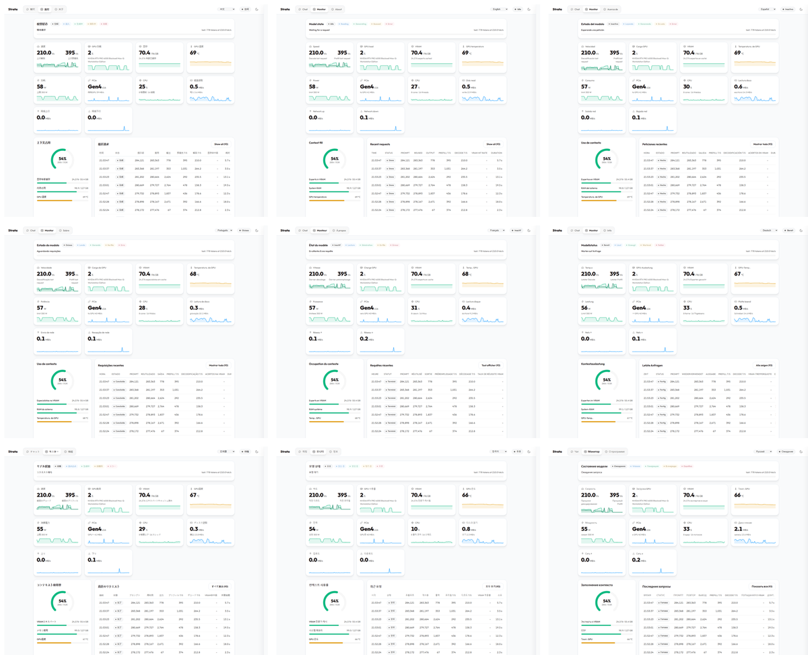

# Strata Monitor Plus

为 [Strata](https://github.com/Niko1221/Strata) 的 Web 监控面板增色的本地补丁集：**多语言界面（中文/English/Español/Português）+ 网络流量监控 + 显卡风扇控制 + 并发槽位可视化**。

零第三方依赖（Python 标准库 + Strata 自带运行时），不修改模型与推理行为，可随 Strata 升级一键重放。

> **看视频了解一切（78 秒，带中文讲解）**：<https://github.com/UNIT-4/strata-monitor-plus/releases/download/v1.0/demo.mp4>

## 🌐 多语言界面 / Languages

安装后，状态胶囊左侧出现**同款样式的语言胶囊**：**中文 / English / Español / Português / Français / Deutsch / 日本語 / 한국어 / Русский** 九语一键切换，选择自动记住（也可用 `?lang=ja` 等 URL 参数强制）。默认中文。
After installing, a language pill appears left of the status pill — nine languages, one click; your choice is remembered.



实现方式：编译期整句替换（中文，性能零损耗）+ 运行时两阶段 i18n 引擎（zh→en→目标语言，含动态内容与属性翻译，250ms 防抖 MutationObserver，缺词自动回落英文）。新增一种语言 = 往 `i18n.js` 的 `DICTS` 里加一张"英文→目标语言"词典，欢迎 PR。

## 功能

| 补丁 | 功能 | 生效方式 |
|---|---|---|
| `patch_strata_monitor_cn.py` | 面板完整中文化（聊天/监控/关于/采样抽屉 200+ 处）；监控页新增「网络上行/下行」实时卡片 | 前端刷新即生效；网络卡片需重启 Strata |
| `patch_strata_i18n.py` | 语言胶囊（9 语言：中英西葡法德日韩俄），两阶段运行时翻译引擎，动态文本全覆盖，缺词回落英文 | 刷新即生效 |
| `patch_strata_fan.py` | 监控页内嵌「显卡风扇」控制卡：系统默认 / 中等(温控曲线) / 激进 / 自定义滑块(30-100%)。88°C 强制满速、83°C 警戒拉升、Strata 退出自动交还驱动、设置持久化重启恢复 | 需重启 Strata |
| `patch_strata_slots.py` | 「并发槽位」卡：每槽状态/进度/tok/s、空闲槽暂存 token 数、排队与准入计数；「快车道·独占直通」行固定渲染防布局闪烁 | 刷新即生效（需双并发 `parallel/batch` 模式启动） |
| `patch_strata_cfg_cn.py` | 关于页「模型设置」表单 16 字段中文化（含开/关、default 等选项） | 刷新即生效 |

## 使用

```bash
# Windows / Linux / macOS，Python 3.8+，需先停止 Strata 服务（保护后端文件热替换）
python apply.py                # 自动探测 Strata 安装目录
python apply.py D:\strata\Strata   # 或显式指定（含 serve 子目录的那层）
# 环境变体：也可设 STRATA_ROOT 环境变量
```

脚本按固定顺序执行五个幂等补丁（重复运行自动跳过已打项），并对将被修改的每个文件生成 `.orig-plus` 首次备份。

**升级 Strata 后**：重跑 `python apply.py` 即可全部重放。补丁自带"空白弹性匹配"（上游仅改换行缩进时仍可命中）；若仍报告 MISS（上游改了锚点），欢迎提 issue。

## 卸载

每个被改文件旁都有 `.orig-plus` 备份，逐个复制回去即可；或删除补丁注入的标记段落（各脚本内可见）。

## 原理与边界

- 前端为纯 HTML/JS 注入，不改协议与 API；后端仅遥测采样与一个 `/fan` 受保护路由（同源 JSON 才可写，随 Strata 现有鉴权）
- 风扇控制使用 NVIDIA NVML（ctypes 直调 `nvml.dll`，与 Strata 遥测同方式），仅支持 NVIDIA 显卡；AMD/不支持的环境卡片显示不可用
- 网络卡片统计全机网卡流量（psutil 差值），非 Strata 进程单独流量
- i18n 引擎只在非中文模式启用翻译遍历；中文模式恢复原始快照，零额外开销
- 上游 Strata 为 MIT 许可证；本项目同 MIT，衍生修改请注明出处

## 版本适配

在 Strata **v0.2.3.1 与 v0.2.6（engine 0.1.48 / 0.1.50）** 上开发与实测（Windows）。槽位可视化依赖官方 `/metrics` 的 `live.slots` 字段（0.2.x 均输出）；其余补丁不依赖特定版本。

## 演示

78 秒中文讲解视频（Releases 附件，点击即播/可下载）：<https://github.com/UNIT-4/strata-monitor-plus/releases/download/v1.0/demo.mp4>

## 许可

MIT。风扇策略参数（中等/激进曲线、保护线）可自由修改——文件内有中文注释。
